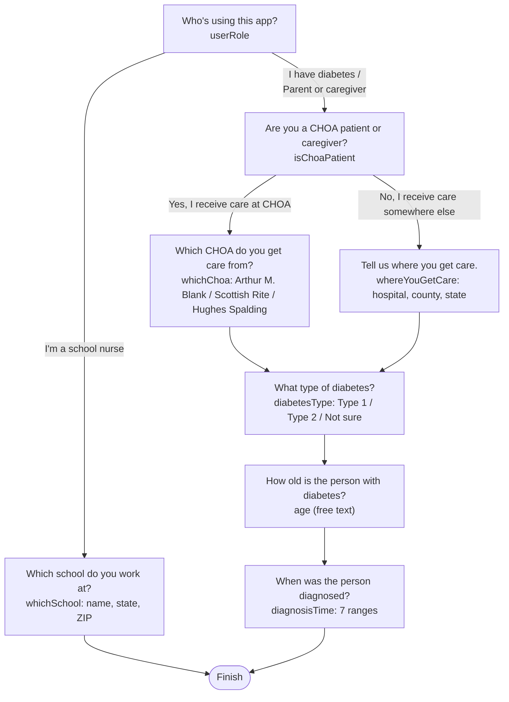
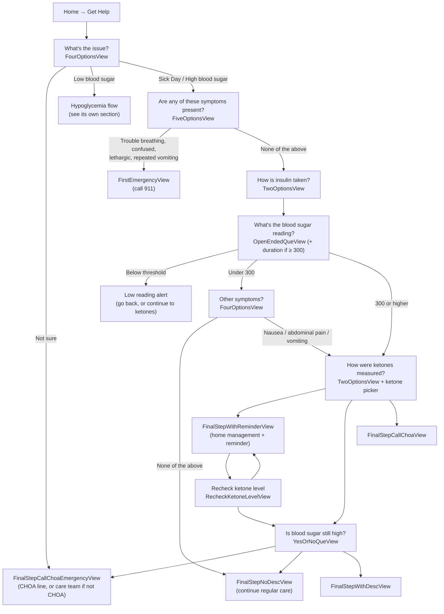
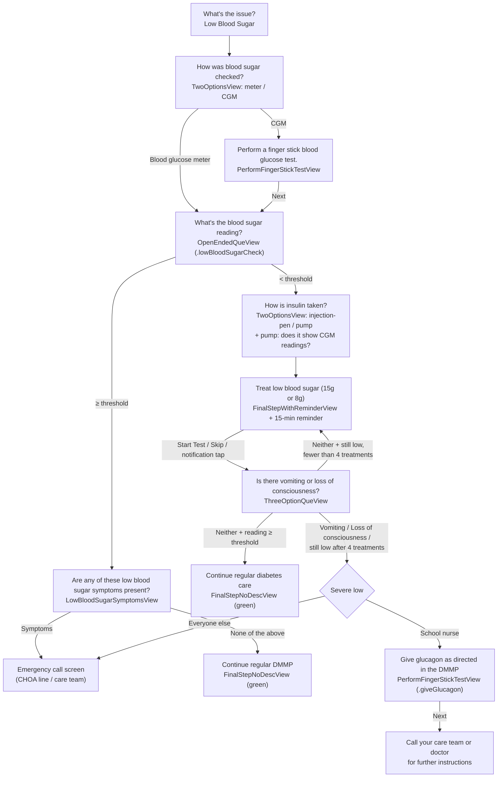

# CHOA Diabetes Education Mobile App

## Table of Contents

- [Overview](#overview)
- [Purpose](#purpose)
- [Current Status](#current-status)
- [Features](#features)
- [Project Structure](#project-structure)
  - [Directory Layout](#directory-layout)
  - [Relevant Files](#relevant-files)
- [App Onboarding](#app-onboarding)
  - [Question Graph](#question-graph)
  - [How Answers Are Used](#how-answers-are-used)
- [Sick Day / Get Help Flow](#sick-day--get-help-flow)
  - [How the Flow Is Built](#how-the-flow-is-built)
  - [State and Persistence](#state-and-persistence)
  - [Step-by-Step Walkthrough](#step-by-step-walkthrough)
  - [Supporting Subviews](#supporting-subviews)
  - [Reminders and Notifications](#reminders-and-notifications)
  - [Back Navigation, Counters, and Resets](#back-navigation-counters-and-resets)
  - [Screen Theming](#screen-theming)
- [Low Blood Sugar (Hypoglycemia) Flow](#low-blood-sugar-hypoglycemia-flow)
  - [Hypo Walkthrough](#hypo-walkthrough)
  - [Treat, Wait 15 Minutes, Recheck](#treat-wait-15-minutes-recheck)
  - [Severe Low: Who Sees What](#severe-low-who-sees-what)
  - [Hypo Screens](#hypo-screens)
- [Emergency Call Routing (CHOA vs. Care Team)](#emergency-call-routing-choa-vs-care-team)
- [How To: Extend the Questionnaire](#how-to-extend-the-questionnaire)
  - [Add a New Question (Existing Type)](#add-a-new-question-existing-type)
  - [Add a New Question Type](#add-a-new-question-type)
  - [Show a Screen](#show-a-screen)
- [Calculator Flows](#calculator-flows)
  - [Know Your Carbs](#know-your-carbs)
  - [Meal and High-Blood-Sugar Calculators](#meal-and-high-blood-sugar-calculators)
  - [Calculator Keyboard and Editing](#calculator-keyboard-and-editing)
- [App-Wide UI Conventions](#app-wide-ui-conventions)
- [Acknowledgements](#acknowledgements)
- [License](#license)
- [Contact](#contact)

## Overview
This mobile application is designed to support families with children newly diagnosed with Type 1 Diabetes at Children's Healthcare of Atlanta (CHOA). The app serves as a crucial educational and support tool, currently being utilized in an observational study to assess its effectiveness in helping families navigate the challenges of Type 1 Diabetes management.

## Purpose
The primary goal of this application is to provide:
- Educational resources for families new to Type 1 Diabetes management
- Support tools for daily diabetes care
- Information and guidance during the critical initial period after diagnosis
- A platform for collecting observational study data to improve diabetes care

## Current Status
The application is actively being used in an observational study at Children's Healthcare of Atlanta, helping to gather valuable data on how families adapt to and manage Type 1 Diabetes diagnoses.

## Features
- Medically verified educational content by the CHOA diabetes Team
- Resources for new onset patients
- Calculator guidance for insulin for food, high blood sugar, or both
- A **Know Your Carbs** food catalogue and carb-counting flow
- A first-launch **App Onboarding** questionnaire (role, CHOA status, care location or school, diabetes type, age, time since diagnosis) whose answers personalise the Get Help flows
- A guided **Sick Day / Get Help** triage questionnaire with ketone tracking and recheck reminders
- A **Low Blood Sugar (Hypoglycemia)** flow with age-based thresholds, 15g/8g carb treatment, 15-minute recheck reminders, and escalation (glucagon for school nurses, a call to CHOA or the family's own care team for everyone else)

## Project Structure

The app is a UIKit project (no SwiftUI app lifecycle). Screens are built from storyboards and XIBs; there is no dependency-injection container — shared state lives in a handful of singletons. Third-party packages are resolved through SwiftPM: **Lottie**, **Firebase (Crashlytics)**, and **Pendo** (analytics).

### Directory Layout

```
choa-diabetes-education/                     # repo root
├── choa-diabetes-education.xcodeproj
├── README.md
└── choa-diabetes-education/                 # app target
    ├── Delegates/                           # AppDelegate, SceneDelegate
    ├── Models/                              # Questionnaire graph, question/answer enums, carb + content models
    ├── Managers/                            # Singletons: Get Help questionnaire, app onboarding, reminders, carb totals, custom foods, calculator constants
    ├── Helpers/                             # Reminder persistence + notification-tap routing
    ├── ViewControllers/                     # One class per screen
    ├── Views/
    │   ├── AppOnboardingQuestionView.swift  # The single, data-driven onboarding question screen
    │   ├── QuestionnaireViews/              # Every Get Help screen body, Sick Day and Hypo (XIB-backed UIViews)
    │   └── PopUps/                          # InfoPopUpViewController
    ├── CustomComponents/                    # PrimaryButton, RoundedButton, RoundedButtonWithImage
    ├── Extensions/                          # UIColor/UIFont/UILabel/UIView helpers, external URLs
    ├── Base.lproj/                          # Main.storyboard, LaunchScreen, Orientation~
    ├── choa-diabetes-education/Base.lproj/  # Calculator.storyboard, Orientation.storyboard
    ├── AppOnboarding.storyboard             # Launch storyboard: onboarding welcome + question scenes
    ├── GetHelp.storyboard                   # The Get Help scene (Sick Day + Hypo) and the ketone info sheet
    ├── Assets/                              # Asset catalogue, fonts, Lottie animations, 32 HTML chapter pages + css/js
    ├── Localizable.strings                  # All user-facing copy
    ├── plists/GoogleService-Info.plist
    └── Info.plist
```

### Relevant Files

| Area | File | Role |
| --- | --- | --- |
| Launch | `Delegates/SceneDelegate.swift` | The scene launches from `AppOnboarding.storyboard`; once onboarding is complete it swaps the root to `Main.storyboard`. |
| Onboarding | `ViewControllers/AppOnboardingWelcomViewController.swift`, `ViewControllers/AppOnboardingViewController.swift`, `Views/AppOnboardingQuestionView.swift` | Welcome screen, the one reusable question screen (pushed once per question), and its data-driven body. |
| Onboarding | `Models/AppOnboardingQuestion.swift` | Every onboarding question, its options/fields, and the `next` / `previous` branching. |
| Onboarding | `Managers/AppOnboardingManager.swift` | Stores the answers and exposes the derived values the rest of the app reads (`isSchoolNurse`, `isChoaPatient`, `age`, `lowBloodSugarThreshold`). |
| Entry | `ViewControllers/HomeViewController.swift` | Home screen; launches Get Help, the calculators, Know Your Carbs, and the education sections. Also finishes a pending notification tap or restores an in-progress reminder when it appears. |
| Get Help | `ViewControllers/GetHelpViewController.swift` | The single view controller used for **every** step of the Sick Day and Hypo flows. |
| Get Help | `GetHelp.storyboard` | Scene holding all step views plus the ketone-measurement info sheet. |
| Get Help | `Managers/QuestionnaireManager.swift` | Singleton that owns the `GetHelpSession` (answers, ketone readings, visit counts), the routing rules for both flows, and session persistence. |
| Get Help | `Models/Questionnaire.swift`, `Models/QuestionType.swift` | The question object passed between screens and the enums for every question id / answer / outcome (`FinalQuestionId`). |
| Get Help | `Views/QuestionnaireViews/*` | The step bodies (see [Supporting Subviews](#supporting-subviews) and [Hypo Screens](#hypo-screens)). |
| Reminders | `Managers/ReminderManager.swift` | Schedules local notifications (2 h, 90 min, 15 min), tags them with `userInfo`, and drives countdowns. |
| Reminders | `Helpers/ReminderPersistence.swift` | Saves the reminder id, time, page and a copy of the whole `GetHelpSession` so a relaunch can reopen the reminder page. |
| Reminders | `Helpers/NotificationHandler.swift` | Routes a notification tap to the right recheck screen (ketones, iLet, or low blood sugar), carrying visit counts across the new stack. |
| Carbs | `ViewControllers/KnowYourCarbsViewController.swift`, `KnowYourCarbsResultViewController.swift`, `AddFoodItemViewController.swift` | The carb catalogue, its results screen, and custom-food entry. |
| Carbs | `Managers/CarbsCalculatorManager.swift`, `Managers/CustomFoodsManager.swift`, `Models/CarbFood.swift` | Selected servings/total, user-added foods, and the food model. |
| Calculators | `ViewControllers/Calculator*ViewController.swift`, `Managers/CalculatorConstantsManager.swift` | Insulin calculators and the stored clinician constants. |
| Education | `ViewControllers/ChapterViewController.swift`, `Models/Content.swift`, `Assets/pages/*.html` | Handbook chapters rendered in `WKWebView`, plus the quizzes. |

## App Onboarding

On first launch the app opens on `AppOnboarding.storyboard` instead of Home. A welcome screen (`AppOnboardingWelcomViewController`, **Get Started**) leads into a short questionnaire. `SceneDelegate` checks `AppOnboardingManager.shared.hasCompletedOnboarding` on every launch and goes straight to `Main.storyboard` once it is set.

`AppOnboardingViewController` is one reusable screen. Each instance shows one `AppOnboardingQuestion` and is pushed for the next question, so the system Back button walks the history. The body, `AppOnboardingQuestionView`, builds itself from the question's `type`:

| Type | Rendering | Next enabled when |
| --- | --- | --- |
| `.singleSelect([AppOnboardingOption])` | Tappable option rows (optionally with an image) | An option is selected |
| `.openEndedInput(placeholder:)` | One text field | The field is not blank |
| `.openEndedMultipleInput([AppOnboardingInputField])` | A labelled text field per entry | Every field is filled in |

Answers are collected in an `[AppOnboardingQuestion: AppOnboardingAnswer]` dictionary passed from screen to screen. `AppOnboardingAnswer` is `.selection(Int)`, `.text(String)`, or `.multipleText([String])`, with a custom `Codable` implementation. The first screen pre-fills from `AppOnboardingManager.shared.answers` if any are saved.

When the last question is answered, `finishOnboarding()`:

1. Walks the graph again from `.userRole`, following the saved answers, and keeps **only the answers on the path actually taken** (`answersOnTakenPath()`). Answers from a branch the user backed out of are dropped. For example, an age typed in before switching the role to school nurse is not saved.
2. Saves them with `AppOnboardingManager.saveAnswers(_:)`, which also sets `hasCompletedOnboarding`.
3. Cross-fades the window's root view controller to `Main.storyboard`.

### Question Graph

Branching lives in `AppOnboardingQuestion.next(selectedOptionId:)`. `previous(previousSelectedOptionId:)` mirrors it.



School nurses are never asked the CHOA, diabetes-type, age, or diagnosis questions.

> The `whichSchool` placeholders in `Localizable.strings` are shifted: the State field says *"Enter county"* and the ZIP field says *"Enter state"*. Fix this in the strings file, not the model.

### How Answers Are Used

`AppOnboardingManager` (stored in `UserDefaults` under `app_onboarding_answers` and `app_onboarding_has_completed_onboarding`) exposes derived values that the Get Help flows read directly:

| Property | Derived from | Used for |
| --- | --- | --- |
| `isSchoolNurse` | `userRole == 2` | Severe hypo branch: school nurses are told to give glucagon, then call the care team. |
| `isChoaPatient` | `isChoaPatient`: option 0 → `true`, option 1 → `false`. `nil` when never asked (school nurses) or unanswered. | Every emergency call screen. `false` swaps the CHOA emergency line for *"Call your care team or doctor"* (see [Emergency Call Routing](#emergency-call-routing-choa-vs-care-team)). |
| `age` | `age` text, parsed as a whole number | `lowBloodSugarThreshold`. |
| `lowBloodSugarThreshold` | `age ≤ 5` → **80 mg/dL**, otherwise (or unknown age) → **70 mg/dL** | The hypo reading/recheck cut-off, and the low-reading alert on the Sick Day blood-sugar question. |

`clear()` removes both keys, which shows onboarding again on the next launch.

## Sick Day / Get Help Flow

**Get Help** on the Home screen opens a questionnaire that starts with *"What's the issue?"*. **Sick Day** and **High Blood Sugar** go into the Sick Day flow described here. **Low Blood Sugar** goes into the [Hypoglycemia flow](#low-blood-sugar-hypoglycemia-flow). **Not Sure** goes to the emergency call screen. The Sick Day flow triages a sick child through symptoms, insulin-delivery method, blood sugar, and ketone levels. It ends on one of several outcome screens, from "continue regular care" to "call 911".

Both flows are driven by `GetHelpViewController.swift` and `QuestionnaireManager.swift` and share the machinery below.

### How the Flow Is Built

- **One view controller, many screens.** `GetHelpViewController` is instantiated from `GetHelp.storyboard` with `init(navVC:currentQuestion:coder:)`. Its scene contains *every* step view as an outlet stacked in the same scene. `viewDidLoad()` calls `hideAllViews()` and then `setupViews()`, which unhides exactly one view based on `questionObj.questionType` and wires itself as that view's delegate.
- **Each answer pushes a new instance.** Step views report answers to the controller via their `…ViewProtocol` delegates. The controller forwards to `QuestionnaireManager`, which builds the next `Questionnaire` object and calls back through `QuestionnaireActionsProtocol.showNextQuestion(_:)`. That method instantiates another `GetHelpViewController` and pushes it, so each answered question becomes a navigation-stack entry and the system Back button walks the history.
- **`Questionnaire` is the payload.** It carries `questionId`, `questionType`, `question`, `answerOptions`, and — for outcome screens — a `FinalStep` (title, description, image name). `QuestionType` decides which view is shown; `questionId` decides the copy and the branch logic inside that view.
- **Copy lives in `Localizable.strings`.** Question titles and option labels are localized keys (`GetHelp.Que.*`, `Calculator.Que.*`, `Calculator.Final.*`, `Final.*`).



### State and Persistence

`QuestionnaireManager.instance` is the single source of truth for the run. Everything recorded during one Get Help run lives in one `Codable` value, `GetHelpSession`, held in `manager.session`. Its `didSet` writes the whole session to `UserDefaults` under `getHelpSession` on every change, and `init` loads it back. A backgrounded or relaunched app therefore resumes with the same answers. The old per-field keys (`persistedUrineKetoneLevel`, `firstUrineKetoneValue`, `reminderPageVisitCount`, `ketoneVisitCount`, …) are removed on launch by `removeLegacyKeys()`.

The instance is long-lived, because views and view controllers keep a reference to it. So it is never replaced: `HomeViewController` calls `manager.reset()` before starting a new run, and the nav bar's X button calls it again on exit. Both replace `session` with a fresh `GetHelpSession()`. The manager still exposes the old property names (`currentTestType`, `iLetPump`, `urineKetones`, …) as accessors over `session`, so routing code reads and writes them as before.

| `GetHelpSession` field | Meaning |
| --- | --- |
| `testType` | `.insulinShots` or `.pump` |
| `iLetPump` | Whether the pump is an iLet (changes every timing threshold and much of the routing) |
| `cgm` | Sick Day: unused by current routing. Hypo: CGM vs. meter, overwritten for pump users by *"Does the pump show CGM readings?"* (drives the 8g treatment) |
| `measuringMethod` | `.urineKetone` or `.bloodKetone`; switching methods clears the other method's stored value |
| `bloodSugar` | Last reading entered (Sick Day or Hypo) |
| `bloodSugarOver300` / `bloodSugarOver300For3Hours` | Reading was ≥ 300, and for long enough (90 min iLet / 3 h otherwise) |
| `urineKetones` / `bloodKetones` | The current ketone reading |
| `first…KetoneValue` / `second…KetoneValue` | First and second readings, compared in the iLet branches |
| `yesOver2hours` | The wait period has elapsed (2 h, or 90 min on iLet) |
| `skipFirstReminder` | The first reminder was skipped, or never offered because ketones were already elevated |
| `activeReminderId` / `reminderScheduledTime` | The pending reminder, if any |
| `visitCounts` | `VisitCounts`: `reminderPages` (iLet only), `ketoneChecks`, `lowBloodSugarTreatments` |
| `visitCountsBeforeStack` | Counts from screens no longer on the navigation stack (see below) |

**Visit counts are derived, not incremented.** Every time a `GetHelpViewController` appears (push, pop, or a cancelled swipe back), it calls `updateVisitCounts(for: questionPath)`. That recomputes `visitCounts = visitCountsBeforeStack + counts(in: stack)`:

- `.twoOptions(.measuringType)` and `.recheckKetoneLevel` each count one ketone check.
- `.reminder` counts one low blood sugar treatment if its id is a hypo treatment stage (`FinalQuestionId.isLowBloodSugarTreatment`). Otherwise it counts one iLet reminder page, and only when `iLetPump` is set.

`visitCountsBeforeStack` covers the cases where the stack is thrown away but the history must survive: a notification tap pops to Home and pushes a fresh recheck screen, or a relaunch reopens the reminder page. `carryVisitCountsPastStack()`, `carryLowBloodSugarTreatments(atLeast:)`, `carryILetVisitCounts(…)`, `prepareToReshowReminderPage(_:)` and `restoreSession(_:reshowing:)` keep the counts correct in those cases (see [Reminders and Notifications](#reminders-and-notifications)). `VisitCounts` decodes missing keys as 0, so sessions saved by older builds still load.

`printCurrentKetoneState()` dumps all of this to the console; the flow is instrumented with emoji-prefixed logs throughout (`📊` counters, `🧪` ketones, `🔔` notifications).

### Step-by-Step Walkthrough

**1. Entry — "What's the issue?"** (`FourOptionsView`, `questionId: childIssue`)

`HomeViewController.tappedGetHelpButton` calls `QuestionnaireManager.instance.reset()` and builds the first question. Options:

- **Sick Day** or **High Blood Sugar** → `triggerDKAWorkFlow` → symptom check.
- **Low Blood Sugar** → `triggerHypoglycemiaFlow` → the [Hypoglycemia flow](#low-blood-sugar-hypoglycemia-flow).
- **Not Sure What's Wrong** → `triggerCallChoaEmergencyActionFlow` → `FinalStepCallChoaEmergencyView` (CHOA line, or the care-team version for non-CHOA users).

**2. Red-flag symptoms — "Are any of these symptoms present?"** (`FiveOptionsView`, `questionId: childHasAnySymptoms`)

Trouble breathing, confused, lethargic, or repeated vomiting → `triggerFirstEmergencyActionFlow` → `FirstEmergencyView`. **None of the above** → `triggerNoSymptomsActionFlow` → insulin-method question.

**3. "How is insulin taken?"** (`TwoOptionsView`, `questionId: testType`)

- **Injection / Insulin Pen** enables Next immediately.
- **Insulin Pump** embeds a `YesOrNoFollowUpView` asking *"Is insulin delivered using iLet Pump?"*; Next stays dimmed until it is answered, and the answer sets `iLetPump`.

Next saves the test type and calls `triggerTestActionFlow`, which goes to the blood-sugar question for both methods.

**4. "What's the blood sugar reading?"** (`OpenEndedQueView`, `questionType: .openEndedWithMultipleInput(.bloodSugarCheck)`)

The family types the reading in mg/dL. The keyboard is raised automatically once the push finishes.

- **300 or higher** also asks how long it has been above 300 (`HighBloodSugarDuration`: 30 min, 1 h, 1 h 30, 2 h, 2 h 30, 3 h, more than 3 h). `didSelectNextAction(currentQuestion:bloodSugar:durationOver300:)` sets `bloodSugarOver300`. It sets `bloodSugarOver300For3Hours` when the duration reaches the threshold: 90 minutes on iLet, 3 hours otherwise. Any reading of 300 or higher then goes to `triggerKetoneMeasuringTypeActionFlow`.
- **Under 300** → `triggerOtherSymptomsActionFlow`.
- **Below `lowBloodSugarThreshold`** (70 mg/dL, or 80 for age ≤ 5 from onboarding) shows an alert, *"Blood sugar is below N"*. **Choose a different symptom** pops back to *"What's the issue?"*. **Continue with hyperglycemia** clears the over-300 flags and continues to the ketone question. On the later blood-sugar recheck it continues down the below-threshold recheck path instead.

**5. "Are any of these symptoms present?" (second list)** (`FourOptionsView`, `questionId: otherSymptom`)

Nausea, abdominal pain, or vomiting → ketone measurement. **None of the above** → `triggerContinueActionFlow` → `FinalStepNoDescView`.

**6. "How were ketones measured?"** (`TwoOptionsView`, `questionId: measuringType`)

Selecting **Urine Ketone Level** or **Blood Ketone Level** embeds the matching picker (`UrineKetoneLevelView` with six levels, `BloodKetoneLevelView` with three) *inside* this screen; the reading and the Next button are part of the same step. A *"Learn how to measure ketones"* link opens `AboutKetoneMeasurementsViewController` as a sheet. Next saves the level and routes (the screen itself counts as the first ketone check):

- **iLet** → `triggerUrineKetoneForILetActionFlow` / `triggerBloodKetoneForILetActionFlow`. These also store the reading as the *first* ketone value and set `skipFirstReminder` — `false` for negative/low readings (the reminder page is shown), `true` for moderate and high readings.
- **Everything else** → `triggerUrineKetoneLevelActionFlow` / `triggerBloodKetoneLevelActionFlow`:
  - Urine negative or 0.5 → reminder page. Blood low → continue regular care if the wait already elapsed, otherwise the reminder page.
  - Moderate or high (urine 1.5/4/8/16, blood moderate/large) → `FinalStepCallChoaView` when blood sugar is over 300, otherwise the blood-sugar recheck question.

**7. Home management + reminder** (`FinalStepWithReminderView`, `questionType: .reminder`)

The steps shown depend on the delivery method (see the subview table). Three ways forward:

- **Remind Me** schedules a 2-hour local notification (90 minutes on iLet), starts an on-screen countdown, and persists the state. During the countdown the button becomes **Skip This Reminder**; skipping sets `skipFirstReminder`, cancels the notification, and advances the flow.
- When the countdown reaches zero the card reads *"Time to check"* and the button becomes **Start Test**.
- **Yes, Over 2hrs** / **Yes, Over 90 mins** advances immediately.

All three advance through `didSelectYesOverAction(_:)` on the controller with `yesOver2hours` set. For non-iLet users that always means `triggerRecheckKetonesActionFlow`. For iLet users the controller evaluates an ordered set of conditions over `skipFirstReminder` and the visit counts (`getReminderPageVisitCount()`, `getKetoneVisitCount()`):

| # | Condition | Next screen |
| --- | --- | --- |
| 1 | skipped first, reminder visits ≥ 2, high ketones | Blood-sugar recheck |
| 2 | skipped first, reminder visits = 1, high ketones | Recheck ketones |
| 3 | skipped first, reminder visits ≥ 2, moderate ketones | Blood-sugar recheck |
| 4 | skipped first, reminder visits = 1, moderate ketones | Recheck ketones |
| 5 | did not skip, reminder visits > 2, any elevated ketones | Blood-sugar recheck |
| 6 | did not skip, reminder visits 1–2, ketone checks 1–2 | Recheck ketones |
| — | no match (logged as a warning) | Recheck ketones (fallback) |

**8. "Check ketone level" recheck** (`RecheckKetoneLevelView`, `questionType: .recheckKetoneLevel`)

Entering this screen sets `yesOver2hours`; being on the stack counts as another ketone check. It pre-selects whichever measurement method was used before, embeds that picker, and offers a *"Switch to Blood/Urine Ketone"* toggle that swaps the picker and clears the pending selection. Next routes to `triggerRecheckUrineKetoneActionFlow` / `triggerRecheckBloodKetoneActionFlow`, or their `…ForILet…` variants, which compare the new reading against the first one and the visit counters to choose between continuing care, another reminder, a blood-sugar recheck, and calling CHOA.

**9. Blood-sugar recheck** (`OpenEndedQueView`, `.openEndedWithMultipleInput(.bloodSugarRecheck)`; or `YesOrNoQueView`, `.yesOrNo(.bloodSugarRecheck)`)

Most rechecks ask for the reading itself (`createBloodSugarRecheckQuestion`). `triggerBloodSugarRecheckReadingActionFlow` compares it with **180 mg/dL** for iLet and **150 mg/dL** for everyone else. Over the threshold follows the "above" path, otherwise the "below" path. The ketone-recheck branches for a pump after a low reading still use the yes/no form, *"300 mg/dL or higher"*. Both forms end in the same two routines:

- **Above** (`triggerBloodSugarRecheckAboveActionFlow`): non-iLet → `FinalStepCallChoaView`. iLet → the visit-count table (another reminder, another ketone recheck, or the emergency call screen).
- **Below** (`triggerBloodSugarRecheckBelowActionFlow`): continue regular care when a pump user has waited out the interval with low ketones, otherwise the emergency call screen. iLet runs its own visit-count table.

A reading below `lowBloodSugarThreshold` on the recheck shows the same low-reading alert as step 4. `QuestionType.isBloodSugarRecheck` matches both forms, so the back-navigation rules treat them the same.

**10. Outcome screens**

`FirstEmergencyView` (911), `FinalStepCallChoaEmergencyView` (call the CHOA emergency line, or the family's own care team for non-CHOA users; see [Emergency Call Routing](#emergency-call-routing-choa-vs-care-team)), `FinalStepCallChoaView` (managed at home with call instructions), `FinalStepNoDescView` (continue regular care), and `FinalStepWithDescView` (continue regular care with extra hydration / iLet guidance). The nav bar's close button is removed on all of them; Exit or Done returns to Home.

### Supporting Subviews

All of these live in `Views/QuestionnaireViews/` and are XIB-backed `UIView`s loaded in `nibSetup()`/`loadFromNib()`. The first group are top-level step views owned by `GetHelpViewController`; the second group are embedded inside other steps.

**Step views**

| View | Question type | What it does |
| --- | --- | --- |
| `FourOptionsView` | `.fourOptions` | Four image + label option cards with a dimmed Next until one is picked. Serves both *"What's the issue?"* and the second symptom list; the `questionId` chooses the artwork and which `FourOptionsAnswer` is emitted. |
| `FiveOptionsView` | `.fiveOptions` | Same card pattern with five options, for the red-flag symptom check. |
| `TwoOptionsView` | `.twoOptions` | Two option cards plus a `followUpQuestionStackView` that hosts a follow-up view. For `testType` the follow-up is the iLet yes/no; for `measuringType` it is the urine or blood ketone picker (with the ketone artwork and the *"Learn how to measure ketones"* link). Next stays at 30% opacity until the follow-up is answered. In the Hypo flow it also serves *"How was blood sugar checked?"* (meter / CGM) and the low-sugar *"How is insulin taken?"*, whose pump follow-up asks *"Does the insulin pump display show CGM readings?"*. |
| `YesOrNoQueView` | `.yesOrNo` | Yes/No pair with an optional embedded `YesOrNoFollowUpView`. Used for the blood-sugar question (where Yes reveals the duration follow-up) and the blood-sugar recheck (where either answer enables Next immediately). |
| `RecheckKetoneLevelView` | `.recheckKetoneLevel` | The second ketone reading. Hosts the urine or blood picker in `ketoneMeasuringTypeStackView`, pre-selected from `currentMeasuringMethod`, with a *"Switch to…"* toggle and the *"Learn how…"* link. Next only fires while `yesOver2hours` is true. |
| `FinalStepWithReminderView` | `.reminder` | The home-management screen and the reminder engine. `setupCommonUI` then one of `setupForInsulinShots` / `setupForPump` / `setupForPumpWithIlet` builds the step list. The iLet variant runs a six-path decision tree over ketone level, `skipFirstReminder`, and the iLet reminder-page count to decide whether to tell the family to **confirm** the pump site, **change** it, or **disconnect** the pump and dose with a pen. Owns the countdown timer, the Remind Me / Skip / Start Test button states, and the `ReminderManagerDelegate` callbacks. The Hypo flow reuses it for the 15g/8g treatment page (see [Hypo Screens](#hypo-screens)). |
| `FirstEmergencyView` | `.firstEmergency` | Red outcome screen. *"Seek Immediate Medical Attention"*, a rounded call-instructions card, a **Call 911** button (`tel://911`), and Exit. |
| `FinalStepCallChoaView` | `.callChoa` | Home-management outcome with numbered steps. Shows `injectionStackView` for pen users and `insulinPumpStackView` for pump users; `setupPumpRecheck()` collapses the later steps and rewrites the first two to *"Change pump site"* / *"Recheck blood sugar"* when the family has already waited out the interval with low ketones. Body copy is built with `setText(_:boldPhrases:)`. |
| `FinalStepCallChoaEmergencyView` | `.callChoaEmergency` | Orange outcome screen with a **Call CHOA** button (`tel://+404-785-5437`) and Exit. |
| `FinalStepNoDescView` | `.finalStepNoDesc` | Green *"Continue regular diabetes care"* screen: title, illustration, Exit. |
| `FinalStepWithDescView` | `.finalStepWithDesc` | *"Continue regular diabetes care"* with detail. Shows `iLetPumpInfoStackView` (and hides the hydration block) for iLet users, otherwise the hydration guidance. |

**Embedded views**

| View | Embedded in | What it does |
| --- | --- | --- |
| `YesOrNoFollowUpView` | `TwoOptionsView`, `YesOrNoQueView` | A second Yes/No question added to the host's follow-up stack. Its label switches on `questionId`: the iLet question after *Insulin Pump*, or the 3-hour / 90-minute duration question after *blood sugar over 300*. Reports the selection back through `YesOrNoFollowUpViewDelegate`, which enables the host's Next button. |
| `UrineKetoneLevelView` | `TwoOptionsView`, `RecheckKetoneLevelView` | Six tappable level buttons (negative, 0.5, 1.5, 4.0, 8.0, 16.0) in a bordered stack; the chosen button stays at full opacity and the rest dim. Emits the 1-based index through `UrineKetoneLevelDelegate`. |
| `BloodKetoneLevelView` | `TwoOptionsView`, `RecheckKetoneLevelView` | The same pattern with three levels — low (<0.6), moderate (0.6–1.5), large (>1.5) — reported through `BloodKetoneLevelDelegate`. |
| `AboutKetoneMeasurementsViewController` | Presented as a sheet | Explains urine vs. blood ketone measurement. Opened by `didSelectLearnHowAction()` from `TwoOptionsView` or `RecheckKetoneLevelView`, presented at an 85% custom detent. |

| `OpenEndedQueView` | `.openEndedWithMultipleInput` | Numeric blood-sugar entry (mg/dL) that raises the keyboard once pushed. For the first Sick Day reading it adds the *time above 300* picker when the reading is ≥ 300. Below `lowBloodSugarThreshold` it calls `didEnterLowBloodSugar` instead of Next (Sick Day only; the Hypo reading `.lowBloodSugarCheck` has no alert and no duration). |

> `FinalStepView` and `MultipleOptionsView` are still wired into `GetHelp.storyboard` and `GetHelpViewController` and belong to the older correction-factor calculator path (blood sugar + correction factor → ketones → "Small/Large/Shot" results). Their result copy hard-codes the CHOA number `404-785-5437`, so check the CHOA rule before reconnecting them.

### Reminders and Notifications

`ReminderManager.shared` wraps `UNUserNotificationCenter`. `AppDelegate` sets it as the notification-center delegate at launch, so notifications also show as banners while the app is in the foreground. It requests permission when a reminder view is created and schedules one-shot `UNTimeIntervalNotificationTrigger` notifications. It also runs a per-identifier `Timer` that drives the `countdownUpdate` / `countdownFinished` delegate callbacks.

| Method | Used by | Interval constant | `userInfo` carried |
| --- | --- | --- | --- |
| `scheduleTwoHourReminder()` | Sick Day, non-iLet | `twoHourDuration` = 7200 s | none |
| `schedule90MinuteReminder(questionId:reminderPageVisits:ketoneCheckVisits:)` | Sick Day, iLet | `oneHour30Duration` | `iLetReminderQuestionId`, `reminderPageVisits`, `ketoneCheckVisits` |
| `schedule15MinuteReminder(lowBloodSugarTreatments:)` | Hypo treatment page | `fifteenMinuteDuration` | `isLowBloodSugarRecheck = true`, `lowBloodSugarTreatments` |
| `scheduleTestReminder()` | Manual testing | 30 s | none |

> ⚠️ **Testing values are checked in.** `oneHour30Duration` and `fifteenMinuteDuration` at the top of `ReminderManager.swift` are both set to **30 seconds**, with `TODO`s to restore **5400** (90 min) and **900** (15 min). Set them back before a release.

The `userInfo` lets a tap rebuild the right screen even after the app was killed and the session or stack is gone. Without it, a relaunch could restart the hypo treatment count, keep treating instead of escalating, or send iLet users round the ketone recheck forever.

**Tapping a notification.** `ReminderManager.userNotificationCenter(_:didReceive:…)` clears the badge, reads the `userInfo`, posts `ReminderNotificationTapped` (so a reminder page that is already on screen flips to "Time to check"), and calls `NotificationHandler.shared.handleNotificationTap(identifier:isLowBloodSugarRecheck:lowBloodSugarTreatments:iLetReminder:)`. The handler then:

1. **Waits for Home if needed.** If there is no window yet, or the root navigation stack doesn't start with `HomeViewController` (cold launch, or the user is still in onboarding), the tap is stored as `pendingTap`. `HomeViewController.viewDidAppear` calls `handlePendingTap()` first and skips the reminder restore, so the tap wins.
2. **Decides the kind.** A hypo reminder is identified by `isLowBloodSugarRecheck`, or, for notifications scheduled before that flag existed, by a hypo treatment page on the current stack.
3. **Carries history past the stack.** It calls `carryVisitCountsPastStack()`. For a hypo reminder it calls `carryLowBloodSugarTreatments(atLeast:)` with the count from the notification. For an iLet reminder it calls `carryILetVisitCounts(atLeastReminderPages:ketoneChecks:)`.
4. **Clears the persisted reminder** so Home won't also reopen the reminder page, then pops to root.
5. **Pushes the next screen:**
   - Hypo → the *"Is there vomiting or loss of consciousness?"* recheck (`createLowBloodSugarRecheckQuestion()`).
   - iLet → re-pushes the iLet reminder page it was set from (`prepareToReshowReminderPage`) and immediately runs `didSelectYesOverAction`, exactly like tapping **Start Test** after the countdown. The iLet visit-count table therefore picks the next step, and Back returns to the reminder page.
   - Everything else → the ketone recheck screen (`createRecheckKetoneStage`).

**Relaunch with a reminder still pending.** `ReminderPersistence` stores a `ReminderState` (reminder id, scheduled time, the reminder page's `questionId`, and a full copy of the `GetHelpSession`) under `activeReminderState`. It discards the state once the scheduled time has passed. `HomeViewController.checkAndRestoreActiveReminder()` runs once per launch. If a reminder is still pending, `navigateToReminderPage(from:state:)` calls `manager.restoreSession(_:reshowing:)`, restores the countdown in `ReminderManager`, and pushes the reminder page back, whether it is a Sick Day or a hypo treatment page. The page id decides which.

`FinalStepWithReminderView` reconciles all three sources on appearance: persisted state first, then an in-memory `ReminderManager` countdown (the case where the user simply navigated back), then the default "Remind Me" state. Leaving the screen invalidates the countdown timer via `cleanup()`.

### Back Navigation, Counters, and Resets

Because every step is a stack entry, Back has to leave the session consistent with the screens that remain. Visit counts take care of themselves: they are recomputed from the stack every time a screen appears (see [State and Persistence](#state-and-persistence)), so popping a reminder page, ketone recheck, or hypo treatment page drops it from the count automatically. Ketone *readings* are not derived, so `GetHelpViewController.viewWillDisappear` checks the screen being popped and the one underneath. `shouldResetKetoneProgress(poppingTo:)` calls `manager.resetKetoneProgress()` when:

- popping the reminder page back to any `.twoOptions` question,
- popping a ketone recheck or a blood-sugar recheck back to the measurement-type question, or
- popping anything back to the insulin-method question (`.twoOptions(.testType)`).

`resetKetoneProgress()` clears `yesOver2hours`, the current/first/second ketone readings, and both `visitCounts` and `visitCountsBeforeStack`.

The nav bar's X button and the Exit button on outcome screens both go through `didSelectExitAction`, which calls `manager.reset()` and pops to root. The Done button (`didSelectGotItAction`) also clears the persisted reminder state before popping back to Home.

### Screen Theming

`updateBackgroundColorForFinalStep(questionId:)` sets both the view background and a matching `UINavigationBarAppearance` (including back-button tint) for outcome screens: red for the 911 screen; orange for the emergency call screen (CHOA or care team), *Perform a finger stick test*, and *Give glucagon*; green for *Continue regular care* and *Continue DMMP*; white elsewhere. `resetBackgroundColor()` restores the white/black default when the screen is popped, and the close button is removed from the nav bar on every outcome screen.

## Low Blood Sugar (Hypoglycemia) Flow

Choosing **Low Blood Sugar** on *"What's the issue?"* starts the hypo flow. It runs on the same `GetHelpViewController` / `QuestionnaireManager` machinery as Sick Day: one pushed screen per step, the shared `GetHelpSession`, and the same reminder engine. The routing lives in the `triggerHypoglycemiaFlow` … `triggerGiveGlucagonNextActionFlow` block near the top of the `QuestionnaireManager` extension.

The threshold for "low" comes from onboarding: `AppOnboardingManager.shared.lowBloodSugarThreshold` is **80 mg/dL** for children aged 5 or under and **70 mg/dL** otherwise, including when the age is unknown.



### Hypo Walkthrough

**1. "How was blood sugar checked?"** (`TwoOptionsView`, `.twoOptions(.bloodSugarCheckMethod)`)

**Blood glucose meter** or **CGM** → `triggerBloodSugarCheckMethodActionFlow`.

- **Meter**: saves `cgm = false` and goes straight to the reading.
- **CGM**: saves `cgm = true` and shows *"Perform a finger stick blood glucose test."* (`.performFingerStickTest`), because a CGM low has to be confirmed with a meter. Its Next (`didSelectFingerStickNextAction`) goes to the reading.

**2. "What's the blood sugar reading?"** (`OpenEndedQueView`, `.openEndedWithMultipleInput(.lowBloodSugarCheck)`)

Unlike the Sick Day reading, there is no time-above-300 follow-up and no low-reading alert. `triggerLowBloodSugarReadingResultActionFlow` stores `bloodSugar` and branches on the threshold:

- **At or above the threshold** (including readings over 300) → *"Are any of these low blood sugar symptoms present?"* (`.lowBloodSugarSymptoms`). It lists shakiness, fast heartbeat, sweating, dizziness, anxiety, hunger, blurry vision, fatigue, headache, and irritability, with one button for having symptoms and one for **None of the above**.
  - Symptoms → `triggerCallChoaEmergencyActionFlow` (CHOA line, or care team for non-CHOA users).
  - None → *"Continue regular diabetes medical management plan (DMMP)."* (`.continueDMMP`, green).
- **Below the threshold** → *"How is insulin taken?"* (`.twoOptions(.lowBloodSugarTestType)`).

**3. "How is insulin taken?"** (`TwoOptionsView`, `.twoOptions(.lowBloodSugarTestType)`)

**Injection / Insulin Pen** enables Next immediately. **Insulin Pump** embeds a `YesOrNoFollowUpView`, *"Does the insulin pump display show CGM readings?"*, and Next stays dimmed until it is answered. `triggerLowBloodSugarTestTypeActionFlow` saves the test type and, for pumps, overwrites `cgm` with the follow-up answer, then shows the first treatment.

### Treat, Wait 15 Minutes, Recheck

**4. Treatment page** (`FinalStepWithReminderView`, `.reminder(.treatLowBloodSugar15g / .treatLowBloodSugar8g)`)

`showLowBloodSugarTreatment()` picks the dose:

| Condition | Stage | Instruction |
| --- | --- | --- |
| Pump **and** the pump shows CGM readings **and** blood sugar > 50 mg/dL | `.treatLowBloodSugar8g` | *Give 8g of fast-acting carbohydrate*: 2 oz (60 mL) juice or 2 glucose tablets |
| Anything else | `.treatLowBloodSugar15g` | *Give 15g of fast-acting carbohydrate*: 4 oz (120 mL) juice or 4 glucose tablets |

A pump that shows CGM readings is already cutting back insulin, so it only needs 8g, unless the reading is 50 or lower.

`FinalStepWithReminderView` detects a hypo stage (`FinalQuestionId.isLowBloodSugarTreatment`) and switches to `setupForLowBloodSugar`: the Sick Day step lists and the *Yes, over 2hrs* block are hidden, and the reminder card reads *"Next check in 15 mins"*. The buttons behave as on the Sick Day reminder page, with three differences:

- **Remind Me** schedules `schedule15MinuteReminder(lowBloodSugarTreatments:)`, passing the current treatment count, and starts the countdown.
- **Skip This Reminder** cancels it and moves on. Unlike Sick Day, skipping does **not** set `skipFirstReminder` or `yesOver2hours`, because those only drive ketone routing.
- When the countdown ends the button becomes **Start Test**.

All three paths, plus tapping the notification, call `didSelectYesOverAction`. For a hypo stage that goes straight to `triggerLowBloodSugarRecheckActionFlow`.

**5. "Is there vomiting or loss of consciousness?"** (`ThreeOptionQueView`, `.threeOptions(.vomitingOrLossOfConsciousness)`)

The screen shows two picture cards (**Vomiting**, **Loss of consciousness**) and a full-width **Neither** option. Picking **Neither** reveals *"What's the blood sugar reading?"*, and Next needs that reading. The view shrinks for the keyboard so Next stays visible. It emits a `LowBloodSugarRecheckAnswer` (`.vomiting`, `.lossOfConsciousness`, or `.neither(bloodSugar)`) to `triggerLowBloodSugarRecheckAnswerActionFlow`:

| Answer | Next |
| --- | --- |
| Vomiting or Loss of consciousness | Severe low: carbs by mouth aren't safe |
| Neither, reading ≥ threshold | *Continue regular diabetes care* (`.continueRegularCare`, green) |
| Neither, still low, and **4** treatment pages already on the stack (`maxLowBloodSugarTreatments`) | Severe low |
| Neither, still low, fewer than 4 treatments | Another treatment page (step 4), with the 15g/8g choice re-evaluated against the new reading |

The treatment count is `visitCounts.lowBloodSugarTreatments`. It is derived from the treatment pages on the navigation stack, so going Back from a treatment page un-counts it. The count also travels in the 15-minute notification's `userInfo`. A tap after the app was killed, which pops the stack, still escalates on time instead of starting the count over (`carryLowBloodSugarTreatments(atLeast:)`).

### Severe Low: Who Sees What

`triggerSevereLowBloodSugarActionFlow` branches on the onboarding role:

| User (from onboarding) | Screens |
| --- | --- |
| **School nurse** (`isSchoolNurse`) | *"Give glucagon as directed in the diabetes medical management plan (DMMP)."* (`.giveGlucagon`, orange, **Next**) → *"Call your care team or doctor for further instructions"* (`.callCareTeam`: no phone number, no call button, Exit only) |
| **CHOA patient / caregiver** (`isChoaPatient == true`) | *"Call CHOA Emergency 404-785-5437 for further instructions"* with **Call CHOA emergency line** and Exit |
| **Not a CHOA patient** (`isChoaPatient == false`) | *"Call your care team or doctor for further instructions"*, Exit only |
| CHOA question unanswered (`isChoaPatient == nil`) | CHOA emergency line (the default) |

The glucagon screen reuses `PerformFingerStickTestView`: same orange layout, different title and image (`will_drugs`). Its Next is routed by `didSelectFingerStickNextAction`, which checks for `.giveGlucagon` and calls `triggerGiveGlucagonNextActionFlow` → `.callCareTeam`.

### Hypo Screens

| View | Question type | Role in the hypo flow |
| --- | --- | --- |
| `TwoOptionsView` | `.twoOptions(.bloodSugarCheckMethod)`, `.twoOptions(.lowBloodSugarTestType)` | Meter vs. CGM; injection-pen vs. pump, with the pump's *"shows CGM readings?"* follow-up. |
| `PerformFingerStickTestView` | `.performFingerStickTest`, `.giveGlucagon` | Orange instruction screen with an illustration and Next. Shows *"Perform a finger stick blood glucose test."* by default (from the XIB), or the glucagon instruction from `finalStep.title`. |
| `OpenEndedQueView` | `.openEndedWithMultipleInput(.lowBloodSugarCheck)` | The first hypo reading. |
| `LowBloodSugarSymptomsView` | `.lowBloodSugarSymptoms` | Symptom illustrations with *symptoms present* / *None of the above* buttons; no Next. |
| `FinalStepWithReminderView` | `.reminder(.treatLowBloodSugar15g / 8g)` | Treatment instructions + 15-minute reminder. |
| `ThreeOptionQueView` | `.threeOptions(.vomitingOrLossOfConsciousness)` | Two picture options + **Neither**, which reveals the reading field. |
| `FinalStepCallChoaEmergencyView` | `.callChoaEmergency(.callChoaEmergency / .callCareTeam)` | The CHOA emergency line, or the care-team variant (title from `finalStep.title`, number and call button hidden). |
| `FinalStepNoDescView` | `.finalStepNoDesc(.continueDMMP / .continueRegularCare)` | Green endings. |

`FinalQuestionId` gained `performFingerStickTest`, `treatLowBloodSugar15g`, `treatLowBloodSugar8g`, `continueDMMP`, `giveGlucagon`, and `callCareTeam`. `isLowBloodSugarTreatment` is true for the two treatment stages and is what the reminder page, the visit counter, and `NotificationHandler` key off. The copy lives under `GetHelp.Que.BloodSugarCheckMethod.*`, `GetHelp.Que.LowBloodSugarSymptoms.*`, `GetHelp.Que.VomitingOrLossOfConsciousness.*`, `Calculator.Que.PumpShowsCGM.title`, `Final.TreatLowBloodSugar*`, `Final.ReminderNextCheck*LowBloodSugar.text`, `Final.GiveGlucagon.title`, and `Final.CallCareTeam.title`.

## Emergency Call Routing (CHOA vs. Care Team)

Every route to the emergency call screen in both flows goes through one function, `QuestionnaireManager.triggerCallChoaEmergencyActionFlow`. These routes are *Not sure* on the first question, hypo symptoms, severe hypo (non-nurses), and the Sick Day ketone and blood-sugar recheck escalations. The function applies the onboarding answer:

```swift
func triggerCallChoaEmergencyActionFlow(_ currentQuestion: Questionnaire) {
    if AppOnboardingManager.shared.isChoaPatient == false {
        showFinalStage(stage: .callCareTeam, calculation: nil)
    } else {
        showFinalStage(stage: .callChoaEmergency, calculation: nil)
    }
}
```

**A user who said they get care outside CHOA never sees the CHOA number or call button.** They see *"Call your care team or doctor for further instructions"* with Exit only. Always route new emergency endings through this function rather than calling `showFinalStage(stage: .callChoaEmergency, …)` directly.

Both stages render `FinalStepCallChoaEmergencyView`. `setupView` sets the title, phone-number label, and **Call CHOA emergency line** button (`tel://+404-785-5437`) explicitly on every setup: `.callCareTeam` uses `finalStep.title` and hides the number and button, and `.callChoaEmergency` shows *"Call CHOA Emergency"* with both visible. The *"for further instructions"* line below the title is always shown.

Known gaps:

- **School nurses** are never asked the CHOA question (`isChoaPatient == nil`). Outside the severe-hypo glucagon path, for example Sick Day escalations, hypo symptoms, or *Not sure*, they currently get the CHOA emergency line.
- The legacy correction-factor results (`Calculator.Final.Small/Large1/Large2/Shot.description`) hard-code *"☎️ 404-785-5437"* in their copy and do not apply this rule. See the note under [Supporting Subviews](#supporting-subviews).

## How To: Extend the Questionnaire

Three recipes, each with one worked example. The first adds a screen using machinery that already exists; the second adds new machinery; the third covers every way a screen gets pushed on screen.

Recall the four moving parts, because each recipe touches the same ones:

1. **`Models/QuestionType.swift`** — the enums: which question types exist, which question ids exist inside each type, and which answers each type can produce.
2. **`Managers/QuestionnaireManager.swift`** — factories (`create…Question`) that build a `Questionnaire`, and triggers (`trigger…ActionFlow`) that decide what comes next and hand it to `actionsDelegate?.showNextQuestion(_:)`.
3. **`Views/QuestionnaireViews/…`** — the screen body and its delegate protocol.
4. **`ViewControllers/GetHelpViewController.swift`** + **`GetHelp.storyboard`** — the outlet, the `hideAllViews()`/`setupViews()` pair, and the delegate implementation that forwards answers back to the manager.

### Add a New Question (Existing Type)

**Scenario:** after the second symptom list, when the family reports nausea, abdominal pain, or vomiting, ask *"Is your child able to keep fluids down?"* before sending them to the ketone measurement. **No** should go straight to the call-CHOA-emergency screen. This is a plain yes/no question, so `YesOrNoQueView` already does everything the screen needs.

**Step 1 — Add the question id.** In `QuestionType.swift`, extend `YesOrNoQuestionId` with a case and give it an unused number in *that* enum (ids are only unique within their own enum — `shotTwentyFourHours` is `6`, so `7` is free). Keep `id` and `init(id:)` in sync; they are separate switches and drift between them is a real source of bugs in this file.

```swift
enum YesOrNoQuestionId {
    case severeDistress
    // …
    case shotTwentyFourHours
    case fluidsCheck            // new

    var id: Int {
        switch self {
        // …
        case .shotTwentyFourHours:
            return 6
        case .fluidsCheck:
            return 7
        }
    }

    init(id: Int) {
        switch id {
        // …
        case 6:
            self = .shotTwentyFourHours
        case 7:
            self = .fluidsCheck
        default:
            self = .severeDistress
        }
    }
}
```

**Step 2 — Add the copy.** In `Localizable.strings`, next to the other `Calculator.Que.*` / `GetHelp.Que.*` keys:

```
"GetHelp.Que.FluidsCheck.title" = "Is your child able to keep fluids down?";
```

**Step 3 — Add a trigger that builds and pushes the question.** In `QuestionnaireManager.swift`, use the existing `createYesOrNoQuestion` factory. Declare the method on `QuestionnaireManagerProvider` as well, so it stays part of the protocol surface the rest of the flow is written against.

```swift
func triggerFluidsCheckActionFlow(_ currentQuestion: Questionnaire) {
    let createQue = createYesOrNoQuestion(
        questionId: .fluidsCheck,
        question: "GetHelp.Que.FluidsCheck.title".localized(),
        description: nil,
        showDescriptionAtBottom: false
    )
    actionsDelegate?.showNextQuestion(createQue)
}
```

**Step 4 — Point an existing branch at it.** The symptom list reports through `didSelectNextAction(currentQuestion:selectedAnswer: FourOptionsAnswer)` in `GetHelpViewController`. Swap the three symptom cases from the ketone trigger to the new one:

```swift
case .Nausea(_), .AbdominalPain(_), .RepeatedVomiting(_):
    self.questionnaireManager.triggerFluidsCheckActionFlow(currentQuestion)
```

**Step 5 — Handle the answer.** A yes/no screen with no follow-up reports through `didSelectNextAction(currentQuestion:userSelectedType:)`, which the controller already forwards to `triggerYesActionFlow` / `triggerNoActionFlow`. So the routing is written in the manager, not the controller — add a case to each switch:

```swift
// triggerYesActionFlow
case YesOrNoQuestionId.fluidsCheck.id:
    triggerKetoneMeasuringTypeActionFlow(currentQuestion)

// triggerNoActionFlow
case YesOrNoQuestionId.fluidsCheck.id:
    triggerCallChoaEmergencyActionFlow(currentQuestion)
```

**Step 6 — Teach the view about the new id where it branches on it.** `YesOrNoQueView` only un-dims its Next button for the question ids it knows; anything else leaves the button at 30% opacity. Add the id to both tap handlers:

```swift
// didYesButtonTap(_:)
case YesOrNoQuestionId.fluidsCheck.id:
    nextButton.alpha = 1

// didNoButtonTap(_:)
} else if currentQuestion.questionId == YesOrNoQuestionId.fluidsCheck.id {
    nextButton.alpha = 1
}
```

If the new question instead needed a second question on the same screen, this is where you would add it — follow the `bloodSugarCheck` case, which clears `followUpQuestionStackView`, adds a `YesOrNoFollowUpView`, pins its leading/trailing edges, sets itself as the delegate, and keeps Next dimmed until `followUpAnswer != 0`. A follow-up also means using the `selectedAnswer:followUpAnswer:` delegate method instead of `userSelectedType:`, and giving `YesOrNoFollowUpView.setupView` a case for the new id so it knows what to ask.

**Step 7 — Check the counters and back-navigation rules.** Visit counts are derived from the stack, so a new screen only needs attention if routing should count it. In that case, add its type to `visitCounts(in:)` in `QuestionnaireManager`. If backing out past it should discard ketone readings, add it to `shouldResetKetoneProgress(poppingTo:)` in `GetHelpViewController`. A screen outside the reminder/ketone loop, like this one, needs neither. If the new ending is an emergency call, route it through `triggerCallChoaEmergencyActionFlow` so non-CHOA users get their care team instead (see [Emergency Call Routing](#emergency-call-routing-choa-vs-care-team)).

### Add a New Question Type

**Scenario:** a three-card question, *"How long ago was the last insulin dose?"* (under 2 hours / 2–4 hours / more than 4 hours), which no existing view can render.

**Step 1 — Declare the type, its ids, and its answers.** In `QuestionType.swift`. Watch out for name collisions: `ThreeOptionsAnswer` is already taken by the blood-ketone picker, so name the answer after the question, not after the number of options.

```swift
enum QuestionType: Equatable {
    // …
    case lastDoseOptions(LastDoseQuestionId)
}

enum LastDoseQuestionId {
    case lastDoseTiming

    var id: Int {
        switch self {
        case .lastDoseTiming: return 1
        }
    }

    init(id: Int) {
        switch id {
        case 1: self = .lastDoseTiming
        default: self = .lastDoseTiming
        }
    }
}

enum LastDoseAnswer: Equatable {
    case LastDose(LastDoseTiming)
}

enum LastDoseTiming {
    case underTwoHours
    case twoToFourHours
    case overFourHours

    var description: String {
        switch self {
        case .underTwoHours:  return "GetHelp.Que.LastDose.option1".localized()
        case .twoToFourHours: return "GetHelp.Que.LastDose.option2".localized()
        case .overFourHours:  return "GetHelp.Que.LastDose.option3".localized()
        }
    }

    init(id: Int) {
        switch id {
        case 1: self = .underTwoHours
        case 2: self = .twoToFourHours
        case 3: self = .overFourHours
        default: self = .underTwoHours
        }
    }
}
```

**Step 2 — Build the view and its XIB.** Create `Views/QuestionnaireViews/ThreeOptionsView.swift` and `ThreeOptionsView.xib`. The XIB's **File's Owner** class is the view class, and the top-level view is connected to the `contentView` outlet — that is what `nibSetup()` loads and adds as a subview. Copy the conventions from `FourOptionsView`: option cards are `UIView`s (not buttons) collected in an outlet collection, tapped through a `UITapGestureRecognizer` keyed on `view.tag`, and the Next button sits at `alpha = 0.3` until something is selected.

```swift
protocol ThreeOptionsViewProtocol: AnyObject {
    func didSelectNextAction(currentQuestion: Questionnaire, selectedAnswer: LastDoseAnswer)
    func didSelectExitAction()
}

class ThreeOptionsView: UIView {
    static let nibName = "ThreeOptionsView"

    @IBOutlet weak var contentView: UIView!
    @IBOutlet weak var questionLabel: UILabel!
    @IBOutlet weak var nextButton: PrimaryButton!
    @IBOutlet var optionButtons: [UIView]!
    @IBOutlet var optionButtonLabels: [UILabel]!

    private var currentQuestion: Questionnaire!
    weak var delegate: ThreeOptionsViewProtocol?
    private var selected = 0

    override init(frame: CGRect) {
        super.init(frame: frame)
        nibSetup()
    }

    required init?(coder aDecoder: NSCoder) {
        super.init(coder: aDecoder)
        nibSetup()
    }

    private func nibSetup() {
        Bundle.main.loadNibNamed(ThreeOptionsView.nibName, owner: self)
        addSubview(contentView)
        contentView.frame = self.bounds
        contentView.autoresizingMask = [.flexibleWidth, .flexibleHeight]
    }

    func setupView(currentQuestion: Questionnaire) {
        self.currentQuestion = currentQuestion
        questionLabel.font = .nunitoMedium
        questionLabel.numberOfLines = 0
        questionLabel.textColor = .headingGreenColor
        questionLabel.text = currentQuestion.question
        questionLabel.textAlignment = .left

        optionButtons.forEach {
            $0.layer.cornerRadius = 8
            $0.layer.borderWidth = 1
            $0.layer.borderColor = UIColor.highlightedBlueColor.cgColor
            $0.isUserInteractionEnabled = true
        }

        for (index, view) in optionButtons.enumerated() {
            view.addGestureRecognizer(
                UITapGestureRecognizer(target: self, action: #selector(optionButtonViewTapped(_:)))
            )
            view.tag = index
        }

        if let answerOptions = currentQuestion.answerOptions {
            for (index, label) in optionButtonLabels.enumerated() {
                label.text = answerOptions[index].localized()
            }
        }

        if selected == 0 { nextButton.alpha = 0.3 }
        nextButton.layer.cornerRadius = 12
    }

    @objc private func optionButtonViewTapped(_ sender: UITapGestureRecognizer) {
        guard let tappedView = sender.view else { return }

        for (index, view) in optionButtons.enumerated() {
            let label = optionButtonLabels[index]
            if index == tappedView.tag {
                selected = index + 1
                view.updateViewForSelection()
                label.updateLabelForSelection()
                nextButton.alpha = 1
            } else {
                view.updateViewForDeselection()
                label.updateLabelForDeselection()
            }
        }
    }

    @IBAction func didNextButtonTap(_ sender: UIButton) {
        guard selected != 0 else { return }

        switch currentQuestion.questionId {
        case LastDoseQuestionId.lastDoseTiming.id:
            delegate?.didSelectNextAction(
                currentQuestion: currentQuestion,
                selectedAnswer: .LastDose(LastDoseTiming(id: selected))
            )
        default:
            break
        }
    }

    @IBAction func didTapExitButton(_ sender: UIButton) {
        delegate?.didSelectExitAction()
    }
}
```

**Step 3 — Put the view in the storyboard.** Open `GetHelp.storyboard`, drop a plain `UIView` into the `GetHelpViewController` scene's root view alongside the existing step views, set its **Custom Class** to `ThreeOptionsView`, and pin its top, bottom, leading, and trailing to the **safe area** — that is how every other step view is constrained. Leave it visible in the storyboard; visibility is a runtime concern. Then ctrl-drag from the controller to the view to create the outlet.

**Step 4 — Wire it into `GetHelpViewController`.** Four edits, all small, all easy to forget:

```swift
// 1. the outlet created in step 3
@IBOutlet var threeOptionsView: ThreeOptionsView!

// 2. hideAllViews()
threeOptionsView.isHidden = true

// 3. setupViews()
case .lastDoseOptions:
    threeOptionsView.isHidden = false
    threeOptionsView.delegate = self
    threeOptionsView.setupView(currentQuestion: questionObj)

// 4. the delegate implementation, in the question-views extension
extension GetHelpViewController: YesOrNoQueViewProtocol, /* … */ ThreeOptionsViewProtocol {
    func didSelectNextAction(currentQuestion: Questionnaire, selectedAnswer: LastDoseAnswer) {
        switch selectedAnswer {
        case .LastDose(let timing):
            self.questionnaireManager.triggerLastDoseActionFlow(currentQuestion, timing: timing)
        }
    }
}
```

`setupViews()` switches exhaustively over `QuestionType`, so the compiler will point at it the moment you add the case to the enum. Nothing points at `hideAllViews()` — `RecheckKetoneLevelView` is missing from it today and only gets away with it because it is the bottom-most sibling in the storyboard and everything else draws over it. Add your view to both.

**Step 5 — Add the factory and the trigger.** In `QuestionnaireManager.swift`, mirroring `createFourCustomOptionsQuestion`:

```swift
func createThreeCustomOptionsQuestion(
    questionId: LastDoseQuestionId,
    question: String,
    description: String?,
    answerOptions: [String]
) -> Questionnaire {
    let quesObj = Questionnaire()
    quesObj.questionId = questionId.id
    quesObj.questionType = .lastDoseOptions(questionId)
    quesObj.question = question
    quesObj.description = description
    quesObj.answerOptions = answerOptions
    return quesObj
}

func triggerLastDoseActionFlow(_ currentQuestion: Questionnaire, timing: LastDoseTiming) {
    switch timing {
    case .underTwoHours:
        showFinalStage(stage: .continueRegularCare, calculation: nil)
    case .twoToFourHours, .overFourHours:
        triggerKetoneMeasuringTypeActionFlow(currentQuestion)
    }
}
```

**Step 6 — Add the copy**, using the same key shape as the rest of the flow:

```
"GetHelp.Que.LastDose.title"   = "How long ago was the last insulin dose?";
"GetHelp.Que.LastDose.option1" = "Less than 2 hours ago";
"GetHelp.Que.LastDose.option2" = "2–4 hours ago";
"GetHelp.Que.LastDose.option3" = "More than 4 hours ago";
```

**If the new type is an outcome screen instead of a question**, there are three extra steps: add a case to `FinalQuestionId` (with matching `id` and `init(id:)` entries — these two switches have already drifted apart for the existing cases, so add to both deliberately), add a branch to `showFinalStage(stage:calculation:)` that builds the `Questionnaire` through a `createFinalStage…` factory, and add the screen's colours to `updateBackgroundColorForFinalStep(questionId:)`. Outcome screens also clear the nav bar's close button in `setupViews()` (`navigationItem.rightBarButtonItem = nil`) and typically expose `didSelectExitAction` or `didSelectGotItAction` rather than a Next action.

### Show a Screen

Every screen in the flow is a fresh `GetHelpViewController` pushed onto the navigation stack. There are four ways one gets pushed.

**1. From the previous question — the normal path.** A trigger builds the `Questionnaire` and hands it to the delegate. `GetHelpViewController` implements `QuestionnaireActionsProtocol` and does the push:

```swift
// QuestionnaireManager
actionsDelegate?.showNextQuestion(createQue)

// GetHelpViewController
func showNextQuestion(_ question: Questionnaire) {
    let getHelpViewController = UIStoryboard(name: "GetHelp", bundle: nil)
        .instantiateViewController(identifier: String(describing: GetHelpViewController.self)) { [weak self] creator in
            GetHelpViewController(
                navVC: self?.navigationController ?? self!.navVC,
                currentQuestion: question,
                coder: creator
            )
        }

    self.navVC.pushViewController(getHelpViewController, animated: true)
}
```

The delegate is connected in `viewDidLoad` (`questionnaireManager.actionsDelegate = self`), so the *currently visible* controller is always the one that performs the push. Nothing else is needed to "show" a question: build it, pass it to `showNextQuestion`, and the type on the `Questionnaire` selects the view.

**2. As an outcome screen.** Go through `showFinalStage`, which owns the title/description/image for each ending:

```swift
showFinalStage(stage: .callChoaEmergency, calculation: nil)
```

**3. As a flow entry point.** A new entry (a new Home tile, a deep link) builds the first question itself and instantiates the controller directly — note the `manager.reset()` before it, which clears the previous run's answers and counters:

```swift
let manager = QuestionnaireManager.instance
manager.reset()

let firstQues = manager.createFourCustomOptionsQuestion(
    questionId: FourOptionsQuestionId.childIssue,
    question: "GetHelp.Que.ChildIssue.title".localized(),
    description: nil,
    answerOptions: [ /* … */ ]
)

let getHelpViewController = UIStoryboard(name: "GetHelp", bundle: nil).instantiateViewController(
    identifier: String(describing: GetHelpViewController.self)
) { creator in
    GetHelpViewController(navVC: self.navigationController!, currentQuestion: firstQues, coder: creator)
}

self.navigationController?.pushViewController(getHelpViewController, animated: true)
```

The storyboard identifier is the class name, and the `creator:` closure is required because `GetHelpViewController` has no zero-argument initializer worth using — the `required init?(coder:)` fallback builds an empty `Questionnaire` and would render a blank screen.

**4. From outside the flow.** `NotificationHandler.navigateToReminderPage()` (notification tap) and `ReminderPersistence.navigateToReminderPage(from:state:)` (relaunch with a live reminder) both pop to root and push a `GetHelpViewController` the same way, after rebuilding the `Questionnaire` with `createRecheckKetoneStage` / `createFinalStageWithReminder` and restoring the manager's state. If you add a screen that a notification should be able to jump to, it needs a factory that can rebuild its `Questionnaire` from persisted data alone.

**Presenting rather than pushing.** Supplementary content is a separate storyboard scene presented modally, as `didSelectLearnHowAction()` does:

```swift
let storyboard = UIStoryboard(name: "GetHelp", bundle: nil)
if let aboutVC = storyboard.instantiateViewController(
    withIdentifier: "AboutKetoneMeasurementsViewController"
) as? AboutKetoneMeasurementsViewController {
    aboutVC.modalPresentationStyle = .pageSheet
    present(aboutVC, animated: true)
}
```

**Before you call it done**, walk the screen once in the simulator and check: the correct view appears and no other view shows through (`hideAllViews()`), Next un-dims when an answer is selected, Back returns to the previous question without corrupting the reminder/ketone counters, the X button still resets the run, and — for an outcome screen — the background colour, nav-bar tint, and missing close button all match the other endings.

## Calculator flows

### Know Your Carbs

From the Home screen, **Know Your Carbs** opens a searchable catalogue of common foods grouped by category. Category chips jump to a section, and users can:

- Select servings with the `+` and `−` controls on each food row.
- Search across the built-in catalogue and any foods they have added.
- Add a custom food by supplying its name, carbohydrate grams, portion size, and category; custom foods can later be removed with a trailing swipe action.

The selected servings are held in `CarbsCalculatorManager` and their carbohydrate grams are summed live. Once the total is greater than zero, the screen presents a **Total Carbs** sheet with a **Calculate insulin** action. That action opens the results screen, where users can review and adjust the selected foods, enter additional carbohydrates, and provide or update an insulin-to-carb ratio. The food-insulin estimate is calculated from total carbs divided by the ratio and rounded down to the nearest half unit. No estimate is displayed until a positive carb ratio is available.

Selections remain available while moving between the catalogue and results screens; leaving the flow does not turn the carb total into a meal/high-blood-sugar calculator entry.

### Meal and high-blood-sugar calculators

The Home screen offers three calculator paths: insulin for food, insulin for high blood sugar, and both. The app routes food-only and combined requests to the food calculator, and high-blood-sugar-only requests to the high-sugar calculator.

On first use, the selected path opens calculator onboarding. The onboarding collects these clinician-provided constants in order:

1. Insulin-to-carb ratio (`g/unit`)
2. Target blood sugar (`mg/dL`)
3. Correction factor

Values must be positive integers. When complete, they are stored locally and the user is taken to the calculator path they originally selected. The onboarding welcome screen also offers **Skip**, which goes directly to that selected calculator. Saved constants, or a prior onboarding completion, allow later calculator launches to bypass onboarding. Users can edit the carb ratio from the Know Your Carbs results screen.

### Calculator Keyboard and Editing

Both calculators (`CalculatorAViewController` for food or food + high blood sugar, `CalculatorBViewController` for high blood sugar only) use number-pad fields with a **Calculate** keyboard accessory that dismisses the keyboard and shows the result:

- **iOS 26 and later**: a system `UIToolbar` with a `.prominent` *Calculate* bar button item (CHOA green, flexible space before it), so it renders with the system Liquid Glass style.
- **Earlier iOS**: the original 44 pt grey bar with a green *Calculate* `UIButton` on the right.

The same accessory instance is shared by every field on the screen: total carbs and carb ratio in A; blood sugar, target, and correction factor in B. `updateSeeResultAccessoryIfNeeded()` removes it from all of those fields, including correction factor, when the screen leaves result mode.

**Field values are kept when editing starts.** Tapping a field no longer clears it. Calculator A's `textFieldDidBeginEditing` blanking was removed. Calculator B no longer blanks the target and correction-factor fields on focus or restores the stored constant when nothing was typed. Users edit the value in place, and constants from calculator onboarding stay visible.

> **Clinical note:** Calculator values and results support—not replace—the care plan and instructions provided by the child’s diabetes team.

## App-Wide UI Conventions

- **Button corner radius.** Every app button gets a 12 pt radius (`UIButton.standardCornerRadius`). `AppDelegate` calls `UIButton.enforceStandardCornerRadius()` at launch. That swizzles `didMoveToWindow` on `UIButton` only, and applies `applyStandardCornerRadius()` to buttons from the app's own bundle (plain `UIButton` or app subclasses). For `UIButton.Configuration` buttons it also sets a `.fixed` corner style, which iOS 26 would otherwise draw as a capsule. System controls such as the search bar's Cancel button keep their native shape. Don't hard-code other radii on buttons; use the constant (Home's insulin buttons already do).
- **Questionnaire typography** uses the Nunito font family (`UIFont+Extensions`).
- **Know Your Carbs navigation bar.** It is only re-shown on appear/disappear when scrolling actually hid it (`showNavigationBarIfHidden`). Calling `setNavigationBarHidden(false)` mid push/pop on a visible bar drops the back button.

## Acknowledgements

This project has been made possible through the generous support of:

- The National Center for Advancing Translational Sciences of the National Institutes of Health under Award Number UL1TR002378. 
  > *The content is solely the responsibility of the authors and does not necessarily represent the official views of the National Institutes of Health.*

- An anonymous donor from Children's Healthcare of Atlanta

- The 1998 Society

## License
[To be completed with license information]

## Contact
[To be completed with contact information]
